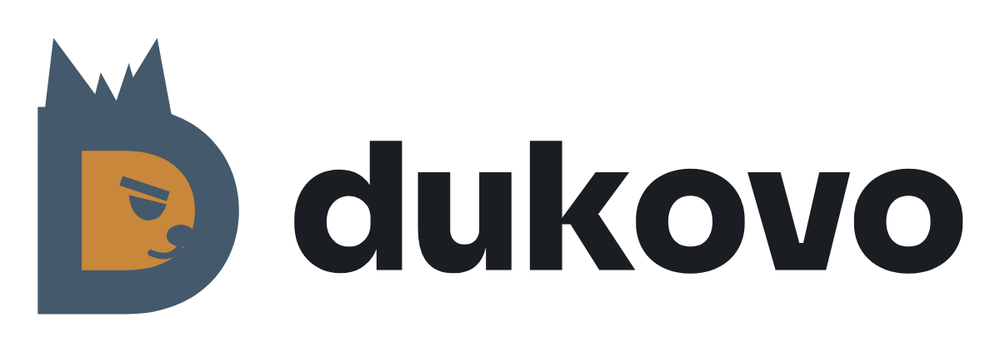

  <picture>
    <source media="(prefers-color-scheme: dark)" srcset="assets/dukovo-dark.png">
    
  </picture>

<h3 align="center">A bright future. A human future.</h3>

  <a href="https://dukovo.org">dukovo.org</a> ·
  <a href="https://github.com/dukovo-os/dukovo">Source</a> ·
  <a href="https://github.com/dukovo-os/dukovo/blob/main/docs/roadmap.md">Roadmap</a> ·
  <a href="https://github.com/sponsors/dukovo-os">Sponsor</a>

---

**Dukovo is a new operating system that answers to you.** It runs on **Radix**, a new kernel written in Rust and built around capabilities: every program gets only what it is given, enforced by the kernel itself.

Dukovo is in development and there is nothing to download yet. **Dukovo Server** comes first, as the 1.0.0 beta. The desktop follows in the 1.x releases.

## What makes it different

- **Security in the kernel, not on top of it.** Apps, services and even Linux programs reach only the files, devices and network you grant them.
- **Fast and memory-safe.** Written in Rust, and measured against Linux on every change. A slower result counts as a bug.
- **Your machine, your rules.** No forced online accounts, no ads, no forced updates or restarts, no TPM requirement, and never any age or ID checks.
- **Plain names.** Folders, commands and settings say what they are, so anyone can find their way around.
- **Your apps come along.** A compatibility layer runs Linux server software at 1.0 and Linux desktop apps later.
- **AI that can't phone home.** Nebix is an optional assistant that runs locally, and the system gives it no network access.

## Repositories

| Repository | What it holds |
| --- | --- |
| [dukovo](https://github.com/dukovo-os/dukovo) | The operating system: the Radix kernel, system services, tools, docs and the roadmap |
| [catalog](https://github.com/dukovo-os/catalog) | The signed app catalog index |
| [bundles](https://github.com/dukovo-os/bundles) | Recipes for apps packaged as Dukovo bundles |
| [sdk](https://github.com/dukovo-os/sdk) | Tools for building Dukovo apps |
| [nebix](https://github.com/dukovo-os/nebix) | Nebix, the optional local assistant |
| [vscodium-extension](https://github.com/dukovo-os/vscodium-extension) | Editor support for Dukovo development |

Dukovo's own code is open source under **Apache-2.0 or MIT**, and every open-source project it builds on is credited by name.

## Support Dukovo

Dukovo has no ads and no investors to answer to. It is paid for by the people who want it to exist. To help, use the **Sponsor** button or [sponsor us on GitHub](https://github.com/sponsors/dukovo-os). Gifts are not tax-deductible.

## Get in touch

- Say hello: hello@dukovo.org
- Report a security issue privately: security@dukovo.org
